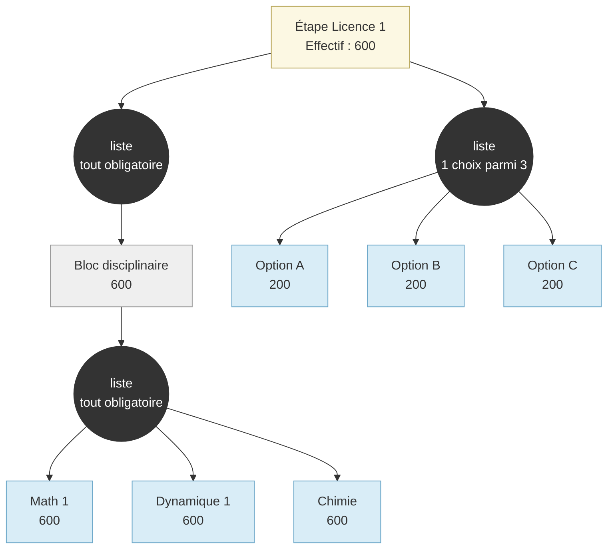
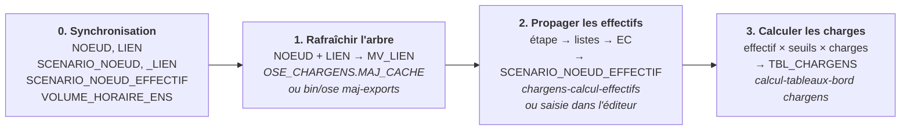

# Module Charges d'enseignement

Fonctionnement, paramétrage, alimentation, traitements automatiques et dépannage du module **Charges d'enseignement** (« chargens » dans le code).

> **Les trois choses à retenir**
>
> 1. Les heures sont calculées **sur les EC**, à partir de l'effectif **de l'EC**. L'effectif saisi ou importé sur l'étape doit d'abord **descendre** dans l'arbre jusqu'aux EC.
> 2. Cette descente s'appuie sur la vue matérialisée `MV_LIEN`, qui **n'est pas rafraîchie automatiquement** quand l'offre de formation est importée.
> 3. L'ordre des traitements est impératif : **synchro → `MV_LIEN` → propagation des effectifs → calcul des charges**.

## Sommaire

1. [À quoi sert le module](#1-à-quoi-sert-le-module)
2. [Les notions à connaître](#2-les-notions-à-connaître)
3. [Vue d'ensemble : la chaîne de calcul](#3-vue-densemble--la-chaîne-de-calcul)
4. [Alimentation des données (connecteurs)](#4-alimentation-des-données-connecteurs)
5. [Calcul 1 : la propagation des effectifs](#5-calcul-1--la-propagation-des-effectifs)
6. [Calcul 2 : groupes, heures et HETD](#6-calcul-2--groupes-heures-et-hetd)
7. [Les seuils et leur ordre de priorité](#7-les-seuils-et-leur-ordre-de-priorité)
8. [Les écrans du module](#8-les-écrans-du-module)
9. [Droits et périmètre](#9-droits-et-périmètre)
10. [Exploitation](#10-exploitation)
11. [Traitements automatiques et crontab](#11-traitements-automatiques-et-crontab)
12. [Mise en place pas à pas](#12-mise-en-place-pas-à-pas)
13. [Dépannage](#13-dépannage)
14. [Annexes](#14-annexes)

---

## 1. À quoi sert le module

Le module calcule, pour chaque enseignement (EC), **le volume d'heures à assurer**, compte tenu :

- des **effectifs d'étudiants** attendus dans chaque formation (par régime : FI, FA, FC) ;
- de la **structure de la formation** : parcours, options, choix obligatoires ou optionnels ;
- des **seuils** d'ouverture et de dédoublement des groupes (CM, TD, TP…) ;
- des **charges d'enseignement** de chaque EC : le nombre d'heures par groupe et par type d'intervention.

Le résultat se lit, pour chaque EC et chaque type d'intervention : **nombre de groupes**, **heures** et **HETD**. Les totaux remontent à l'étape.

Plusieurs hypothèses peuvent être comparées grâce aux **scénarios** : effectifs différents, options fermées, seuils différents…

| Usage | Ce que permet le module |
|---|---|
| Coût de l'offre de formation | Évaluer le volume horaire (heures et HETD) d'une formation, d'une composante ou de l'établissement, pour un scénario donné. |
| Simulation | Mesurer l'impact d'une modification (effectifs, seuils, options) en comparant deux scénarios ou deux exports (écran *Différentiel*). |
| Contrôle des services | Comparer les heures de service saisies par les intervenants aux charges calculées (indicateurs 810 à 840, export *Dépassement*). |

---

## 2. Les notions à connaître

### 2.1 Le scénario

Un **scénario** (table `SCENARIO`) est un jeu complet d'hypothèses : effectifs, liens actifs, choix, poids, seuils. Toutes les données de paramétrage du module sont rattachées à un scénario. Changer de scénario dans l'éditeur affiche donc d'autres effectifs et d'autres heures pour la même formation.

- **Libellé** : il sert aussi de clé au paramètre global `scenario_charges_services` (voir [§10](#101-le-scénario-de-référence-pour-les-services)).
- **Structure** (facultative) : un scénario rattaché à une composante n'est modifiable que par cette composante. Sans structure, c'est un scénario d'établissement.
- **Type** : Local, Prévisionnel ou Réel. Il est seulement informatif (affiché dans la liste des scénarios) et ne change aucun calcul.

### 2.2 L'arbre de formation : nœuds et liens

L'offre de formation est représentée par un **graphe**, importé depuis le SI de scolarité (Apogée, Pégase…).

| Élément | Table | Description |
|---|---|---|
| **Nœud étape** | `NOEUD` avec `etape_id` | Racine d'une formation. C'est **le seul nœud où l'on saisit des effectifs**. Couleur jaune dans l'éditeur. |
| **Nœud élément (EC)** | `NOEUD` avec `element_pedagogique_id` | Enseignement qui porte des charges (CM/TD/TP). C'est là que sont calculés groupes et heures. Couleur bleue. |
| **Nœud intermédiaire** | `NOEUD`, `liste = 0` | Bloc, UE, semestre, parcours… Il ne porte ni effectif saisi ni charge. Couleur grise. |
| **Nœud liste** | `NOEUD`, `liste = 1` | Regroupe des enfants entre lesquels l'étudiant fait un choix, ou qui sont tous obligatoires. Représenté par un **point noir**. |
| **Lien** | `LIEN` | Relie un nœud supérieur à un nœud inférieur. |

> ⚠️ **Règle de structure obligatoire**
>
> Les nœuds doivent **alterner** : nœud → **liste** → nœud → **liste** → nœud… Un lien direct entre deux nœuds « non liste » est **ignoré** par la propagation, puisque la vue `MV_LIEN` ne retient que les triplets nœud / liste / nœud. Le connecteur doit donc toujours intercaler un nœud liste.

Exemple d'arbre, avec un effectif de 600 sur l'étape :



Une liste sans choix transmet 100 % de l'effectif à chaque enfant. Une liste « 1 choix parmi 3 » transmet un tiers de l'effectif à chaque option (poids égaux).

### 2.3 Effectif, régime (type d'heures) et étape d'origine

Un effectif (table `SCENARIO_NOEUD_EFFECTIF`) est toujours défini par :

- un **nœud** dans un **scénario** (`SCENARIO_NOEUD`) ;
- un **type d'heures**, c'est-à-dire le régime d'inscription : **FI**, **FA** ou **FC** ;
- une **étape d'origine** (`etape_id`) : l'étape d'où vient cet effectif. Un EC mutualisé entre plusieurs formations reçoit ainsi plusieurs lignes, une par étape d'origine.

Le nombre affiché sous « Effectifs » dans l'éditeur est la **somme** de toutes ces lignes : tous régimes et toutes étapes d'origine confondus.

### 2.4 Paramètres d'un lien (par scénario)

| Paramètre | S'applique à | Effet |
|---|---|---|
| **Actif** | tout lien | Un lien inactif ne transmet aucun effectif. Sert à « fermer » une option ou un parcours dans un scénario. |
| **Choix minimum / maximum** | lien vers un **nœud liste** | Nombre d'enfants de la liste que choisit chaque étudiant. Vide = tous les enfants sont suivis (100 %). |
| **Poids** | lien d'une liste vers un enfant | Attractivité relative d'un enfant par rapport aux autres options de la même liste. 1 par défaut. |

Table `SCENARIO_LIEN`. Sans ligne pour un lien, les valeurs par défaut s'appliquent : actif, poids 1, pas de contrainte de choix.

### 2.5 Paramètres d'un nœud (par scénario)

| Paramètre | Saisissable sur | Effet |
|---|---|---|
| **Effectifs FI / FA / FC** | nœud **étape** uniquement | Point de départ de la propagation. |
| **Seuil d'ouverture** | étape ou EC, par type d'intervention | Effectif minimal pour ouvrir au moins un groupe. |
| **Seuil de dédoublement** | étape ou EC, par type d'intervention | Taille maximale d'un groupe. |
| **Assiduité** | EC, par type d'intervention | Pourcentage d'étudiants réellement présents (ex. 80 %), appliqué à l'effectif avant de calculer les groupes. |

Tables `SCENARIO_NOEUD` et `SCENARIO_NOEUD_SEUIL`.

### 2.6 Charges d'enseignement d'un EC

Les heures **par groupe** de chaque EC, par type d'intervention (ex. CM 30 h, TD 20 h), sont stockées dans `VOLUME_HORAIRE_ENS`. Elles viennent de l'import (connecteur) ou d'une saisie dans l'offre de formation. **Sans charges, un EC n'a pas d'heures**, quel que soit son effectif.

---

## 3. Vue d'ensemble : la chaîne de calcul

Le calcul se fait en **quatre étapes successives**. Chacune utilise le résultat de la précédente.



Conséquences d'une étape manquante ou faite dans le mauvais ordre :

| Situation | Conséquence |
|---|---|
| Sans l'étape 1 | La propagation ne trouve aucun enfant, les EC restent à 0, et l'étape est quand même marquée « calculée ». |
| Sans l'étape 2 | Les EC n'ont pas d'effectif, donc 0 groupe et des heures « NC ». |
| Sans l'étape 3 | Les heures affichées ne tiennent pas compte des nouveaux effectifs. |
| Étape 2 lancée **avant** l'étape 1 | L'étape est marquée calculée et ne sera plus retraitée, même une fois `MV_LIEN` à jour. |

### Deux façons de déclencher la chaîne

- **Depuis l'éditeur (temps réel)** : quand un utilisateur enregistre une modification dans *Paramétrage des formations*, OSE fait la propagation sous le nœud modifié (étape 2), puis traite immédiatement les demandes de recalcul des charges (étape 3). **L'étape 1 n'est pas faite** : l'éditeur utilise la `MV_LIEN` telle qu'elle est.
- **Par les traitements de nuit (batch)** : les effectifs importés par la synchronisation ne sont **pas** propagés au moment de l'import. Il faut lancer `chargens-calcul-effectifs` (étape 2), puis `calcul-tableaux-bord` (étape 3), après avoir rafraîchi `MV_LIEN` (étape 1).

---

## 4. Alimentation des données (connecteurs)

Le module s'alimente par des vues sources `SRC_*`, synchronisées comme les autres tables d'import (voir [Connecteurs IMPORT](../Connecteurs-Import/Connecteurs-IMPORT.md)). Les exemples Apogée sont dans [Connecteurs-Import/Apogée](../Connecteurs-Import/Apogée/Connecteur.md). La description des colonnes attendues est dans [NOEUD](../Connecteurs-Import/Création-tables/NOEUD.md) et [LIEN](../Connecteurs-Import/Création-tables/LIEN.md).

| Table OSE | Obligatoire ? | Contenu / remarques |
|---|---|---|
| `NOEUD` | **Oui** | Tous les nœuds de l'année : code, libellé, `liste` (0/1), année, étape *ou* élément pédagogique rattaché, structure. Les nœuds EC doivent pointer vers l'`ELEMENT_PEDAGOGIQUE` **de la même année**. |
| `LIEN` | **Oui** | Liens nœud supérieur → nœud inférieur, avec alternance nœud / liste. |
| `VOLUME_HORAIRE_ENS` | **Oui** | Charges des EC par type d'intervention (heures par groupe ; nombre de groupes forcé, facultatif). |
| `SCENARIO_NOEUD` | Facultatif | Création des nœuds étape dans chaque scénario, pour pouvoir y importer des effectifs. OSE crée lui-même les autres `SCENARIO_NOEUD` pendant la propagation. |
| `SCENARIO_LIEN` | Facultatif | Choix minimum / maximum issus du SI (listes à choix). Sinon, saisie manuelle dans l'éditeur. |
| `SCENARIO_NOEUD_EFFECTIF` | Facultatif | Effectifs des étapes par régime et par scénario. Sinon, saisie manuelle dans l'éditeur. |

> ℹ️ **Saisie locale et synchronisation**
>
> Une donnée modifiée dans OSE passe en source **OSE** et n'est **plus jamais écrasée** par la synchronisation. Exemple : un effectif d'étape importé puis corrigé à la main reste à la valeur saisie, même si le SI change ensuite.

Points de vigilance :

- **Année** : nœuds, liens, étapes et éléments doivent être de la même année. Un nœud EC 2026 qui pointe vers un EC 2025 n'aura pas de charges.
- **Nœuds liste** : sans `liste = 1` intercalé, la propagation ne passe pas (voir [§2.2](#22-larbre-de-formation--nœuds-et-liens)).
- **Structure** des nœuds et liens : elle détermine qui peut les modifier ([§9](#9-droits-et-périmètre)) et quels seuils par défaut s'appliquent ([§7](#7-les-seuils-et-leur-ordre-de-priorité)).
- **Traitement postérieur** du job de synchronisation qui contient `NOEUD` et `LIEN` : y ajouter `OSE_CHARGENS.MAJ_CACHE;` (voir [§11](#11-traitements-automatiques-et-crontab)).

---

## 5. Calcul 1 : la propagation des effectifs

La propagation (procédures `OSE_CHARGENS.CALC_SUB_EFFECTIF` → `CALC_EFFECTIF` → `ADD_SCENARIO_NOEUD_EFFECTIF`) fait descendre l'effectif d'une étape jusqu'aux EC. Elle est faite **séparément pour chaque combinaison scénario × régime (FI/FA/FC) × étape d'origine**.

### 5.1 Algorithme

1. On part d'un nœud (en pratique l'étape) et on cherche ses enfants dans `MV_LIEN` (nœud → liste → enfant).
2. Pour chaque enfant, on **remet son effectif à 0** pour ce scénario, ce régime et cette étape d'origine.
3. On parcourt **tous les parents** de l'enfant (un nœud peut être atteint par plusieurs chemins). Pour chaque parent actif, on calcule la part transmise : `effectif du parent × coefficient de la liste`. Cette part est **ajoutée** à l'effectif de l'enfant (`ADD_SCENARIO_NOEUD_EFFECTIF` fait un cumul).
4. Si l'enfant n'existe pas encore dans le scénario, OSE crée sa ligne `SCENARIO_NOEUD`, puis on recommence à l'étape 1 à partir de cet enfant, jusqu'aux feuilles.

Un lien est ignoré si le `SCENARIO_LIEN` correspondant a `actif = 0`, côté liste comme côté enfant.

### 5.2 Le coefficient d'une liste (`CALC_COEF`)

Notations, pour une liste à *n* enfants : *min* et *max* = choix minimum / maximum (portés par le lien qui mène à la liste), *p* = poids de l'enfant, *P* = somme des poids, *p<sub>max</sub>* = plus grand poids.

- *max* vide ou supérieur à *n* → *max* = *n* ;
- *min* vide → *min* = *n* ; *min* > *max* → *min* = *max* ;
- nombre moyen de choix : *c* = (*min* + *max*) / 2 ;
- **coefficient = *c* × *p* / *P*** ;
- sauf si l'enfant le plus « lourd » dépasserait 100 % (*c* × *p<sub>max</sub>* / *P* > 1) : alors **coefficient = *c* / *n*** pour tous les enfants, c'est-à-dire que les poids sont ignorés.

| Cas | Paramètres | Effectif transmis à chaque enfant (parent = 600) |
|---|---|---|
| Liste sans choix (tout est obligatoire) | min, max vides ; n = 3 | c = 3 → 3 × 1/3 = **100 %** → 600 chacun |
| 1 option parmi 3, poids égaux | min = max = 1 | 1 × 1/3 → **200** chacun |
| 2 options parmi 4, poids égaux | min = max = 2 ; n = 4 | 2 × 1/4 = 50 % → **300** chacun |
| 1 parmi 3, option A deux fois plus demandée | poids 2, 1, 1 | A : 1 × 2/4 = **300** ; B et C : **150** |
| 2 parmi 3, poids 4, 1, 1 | c × 4/6 = 1,33 > 1 | poids ignorés : 2/3 → **400** chacun |
| Entre 1 et 3 options parmi 4 | min = 1, max = 3 | c = 2 → 2/4 → **300** chacun |

### 5.3 Ce qui déclenche la propagation

| Déclencheur | Périmètre |
|---|---|
| Enregistrement d'un effectif dans l'éditeur | Sous le nœud étape modifié, pour le régime modifié. Les charges sont recalculées dans la foulée. |
| Modification d'un lien dans l'éditeur (actif, choix, poids) | Sous le nœud concerné. |
| `./bin/ose chargens-calcul-effectifs` | Toutes les lignes d'effectif d'étape, **toutes années**, dont `effectif_calcule <> effectif`. Met ensuite `effectif_calcule = effectif`. **Ne recalcule pas les charges.** |
| Appel manuel `OSE_CHARGENS.CALC_SUB_EFFECTIF(noeud, scenario, type_heures, etape)` | Sous le nœud indiqué. |

> ⛔ **Piège : la colonne `effectif_calcule`**
>
> `chargens-calcul-effectifs` ne retraite **que** les effectifs modifiés depuis son dernier passage. Si elle a tourné avec une `MV_LIEN` périmée, l'étape est marquée calculée alors que rien n'est descendu, et elle ne sera plus jamais retraitée tant que son effectif ne change pas. Pour la débloquer : `UPDATE scenario_noeud_effectif SET effectif_calcule = NULL …` (voir [§13](#séquences-de-correction)).

> ⚠️ **Les effectifs sous l'étape sont recalculés, pas saisis**
>
> Chaque propagation **remet à zéro** puis recalcule les effectifs des nœuds sous l'étape. Toute valeur forcée directement en base sur un nœud intermédiaire ou un EC est donc écrasée. Pour agir sur la répartition, il faut passer par les **liens** : actif, choix, poids.

---

## 6. Calcul 2 : groupes, heures et HETD

Le calcul est porté par la vue `V_TBL_CHARGENS` et matérialisé dans le tableau de bord `TBL_CHARGENS` (une ligne par nœud EC × scénario × régime × type d'intervention × étape d'origine). L'éditeur, les exports et les indicateurs lisent tous `TBL_CHARGENS`.

### 6.1 Conditions pour qu'une ligne existe

Une ligne n'est produite que si **toutes** ces conditions sont remplies :

1. il existe un **effectif** (`SCENARIO_NOEUD_EFFECTIF`) sur le nœud, dans un `SCENARIO_NOEUD` non historisé ;
2. le nœud est relié à un **élément pédagogique** (`NOEUD.element_pedagogique_id`) ;
3. cet élément a des **charges** : `VOLUME_HORAIRE_ENS` non historisé avec `heures > 0`.

Si l'une manque, l'éditeur affiche **« NC »** (non calculé) au lieu d'un nombre. Un nœud étape n'a jamais de ligne propre : ses heures sont la **somme** de celles des EC qui en dépendent.

### 6.2 Formules

Pour un nœud EC, un scénario et un type d'intervention :

```text
effectif_régime   = effectif (FI, FA ou FC) × assiduité
t_effectif        = somme des effectif_régime de tous les régimes et étapes d'origine

si t_effectif = 0  OU  t_effectif < ouverture  OU  dédoublement = 0 :
    groupes = 0
sinon :
    groupes_total = ARRONDI_SUP( t_effectif / dédoublement )
    groupes       = groupes_total × effectif_régime / t_effectif     (répartition au prorata)

heures = groupes × heures_ens                  (heures par groupe dans VOLUME_HORAIRE_ENS)
hetd   = groupes × heures_ens × taux_hetd_service du type d'intervention
```

> ℹ️ **Exemple**
>
> Math 1 reçoit 674 étudiants en FI. TD : dédoublement 36, ouverture 1, assiduité 100 %, 20 h par groupe.
> groupes = ⌈674 / 36⌉ = **19** ; heures = 19 × 20 = **380 h** ; HETD = 380 × 1 = **380**.
> Avec 600 FI et 74 FA : les 19 groupes sont répartis en 16,91 groupes FI et 2,09 groupes FA.

### 6.3 Recalcul de `TBL_CHARGENS`

Des triggers (`T_CRG_*`) posent des **demandes de recalcul** à chaque modification d'effectif, de seuil, de nœud, d'étape ou de charge. Ces demandes sont traitées :

- immédiatement après un enregistrement dans l'éditeur ;
- sinon, au prochain `./bin/ose calcul-tableaux-bord` (complet, ou limité : `calcul-tableaux-bord chargens --annee=2026`).

Appel SQL équivalent : `UNICAEN_TBL.CALCULER('chargens')`, ou avec un filtre : `UNICAEN_TBL.CALCULER('chargens', 'ANNEE_ID', '2026')`. Les paramètres de filtre possibles sont `ANNEE_ID`, `NOEUD_ID`, `SCENARIO_ID`, `ELEMENT_PEDAGOGIQUE_ID`, `ETAPE_ID` et `ETAPE_ENS_ID`.

---

## 7. Les seuils et leur ordre de priorité

Pour chaque EC et chaque type d'intervention, OSE retient la **première valeur renseignée** dans cet ordre :

| Seuil | Ordre de recherche (le premier trouvé l'emporte) |
|---|---|
| **Dédoublement** | 1. seuil saisi sur l'**EC** dans le scénario → 2. seuil saisi sur l'**étape** → 3. **seuils par défaut** (écran *Seuils de dédoublement*, voir ci-dessous) → 4. **1**, c'est-à-dire un groupe par étudiant |
| **Ouverture** | 1. EC → 2. étape → 3. **1** |
| **Assiduité** | 1. EC → 2. **100 %** |

> ⛔ **Piège : un seuil personnalisé n'est pris en compte que si son dédoublement est renseigné**
>
> La vue ne retient un seuil saisi sur un EC ou une étape (`SCENARIO_NOEUD_SEUIL`) que si sa valeur de **dédoublement** est remplie. Un seuil d'ouverture ou une assiduité saisis seuls, sans dédoublement au même niveau, sont **ignorés**. Il faut toujours renseigner le dédoublement en même temps.

> ⚠️ **Dédoublement à 1 par défaut**
>
> Si aucun seuil de dédoublement n'existe à aucun niveau, OSE prend **1** : **un groupe par étudiant**. Les heures deviennent alors énormes (674 étudiants = 674 groupes de TD). Il faut donc toujours définir les seuils par défaut de l'établissement.

### 7.1 Seuils par défaut (écran « Gestion des seuils de dédoublement »)

Ils sont définis **par scénario et par année** (table `SEUIL_CHARGE`), pour chaque type d'intervention, à quatre niveaux de précision :

| Priorité | Niveau |
|---|---|
| 1 | Composante **+** groupe de types de formation (ex. UFR Sciences, Licence) |
| 2 | Composante, tous types de formation |
| 3 | Établissement **+** groupe de types de formation |
| 4 | Établissement, tous types de formation |

Le résultat est matérialisé dans `TBL_CHARGENS_SEUILS_DEF`, recalculé automatiquement à chaque enregistrement sur l'écran. La composante prise en compte est celle de l'**étape** de l'EC, et le groupe de types de formation est celui du type de formation de l'étape.

---

## 8. Les écrans du module

Menu **Charges** de la barre de navigation (route `/chargens`).

| Écran | Rôle |
|---|---|
| **Gestion des scénarios** | Créer, modifier, supprimer (historiser) et **dupliquer** un scénario. Libellé, structure de rattachement. |
| **Gestion des seuils de dédoublement** | Saisir les seuils par défaut ([§7.1](#71-seuils-par-défaut-écran--gestion-des-seuils-de-dédoublement-)) d'un scénario, par composante, groupe de types de formation et type d'intervention. Affiche aussi le total d'heures FI par composante. |
| **Paramétrage des formations** | L'**éditeur graphique** : choix de la composante, de la ou des étapes et du scénario, affichage de l'arbre, saisie des effectifs, seuils, liens. |
| **Export des charges (CSV)** | Fichier complet des charges d'un scénario pour l'année en cours (vue `V_CHARGENS_EXPORT_CSV`). |
| **Différentiel** | Compare deux jeux de charges : deux scénarios ou années en base, ou un fichier CSV exporté précédemment. Les écarts sont détaillés par composante, étape et EC. |
| **Rapprochement charges / services (CSV)** | Pour chaque intervenant et chaque EC, compare les heures de service (prévisionnel et réalisé) aux heures de charges, et calcule le dépassement (vue `V_EXPORT_DEPASS_CHARGES`). |

### 8.1 L'éditeur « Paramétrage des formations »

**Lecture**

- **Jaune** : nœud étape (effectifs, heures, HETD de toute la formation).
- **Gris** : nœud intermédiaire (effectifs).
- **Bleu** : EC (effectifs, nombre de groupes par type d'intervention, heures, HETD).
- **Point noir** : nœud liste.
- **« NC »** : aucune ligne dans `TBL_CHARGENS` (voir [§6.1](#61-conditions-pour-quune-ligne-existe)).

**Saisie**

- **Clic sur un nœud** : fenêtre avec les effectifs FI/FA/FC (étape seulement), les seuils d'ouverture et de dédoublement (étape et EC) et l'assiduité (EC).
- **Clic sur un lien** : choix min/max (lien vers une liste), actif, poids (lien d'une liste vers un enfant).
- **Enregistrer** : la propagation et le recalcul des charges sont immédiats.

Les champs proposés dépendent des privilèges de l'utilisateur et de la composante du nœud ou du lien ([§9](#9-droits-et-périmètre)). Une fenêtre ne s'ouvre pas si aucun champ n'est modifiable.

---

## 9. Droits et périmètre

Catégorie de privilèges **« Charges d'enseignement »** (gestion des rôles).

| Privilège | Permet |
|---|---|
| Visualisation | Accéder au menu Charges. |
| Visualisation des scénarios | Voir la liste des scénarios. |
| Édition des scénarios (composantes / établissement) | Créer, modifier, supprimer un scénario de composante / d'établissement. |
| Duplication de scénario | Dupliquer un scénario vers un autre. |
| Visualisation / Édition des seuils (composantes / établissement) | Voir et modifier les seuils par défaut de niveau composante / établissement. |
| Visualisation des formations | Ouvrir l'éditeur graphique. |
| Édition des formations (effectifs) | Saisir les effectifs des étapes. |
| Édition des formations (seuils) | Saisir les seuils d'ouverture et de dédoublement sur étapes et EC. |
| Édition des formations (assiduité) | Saisir l'assiduité des EC. |
| Édition des formations (activation liens / choix liens / poids liens) | Modifier respectivement les champs actif, choix min/max et poids des liens. |
| Export CSV | Export des charges et Différentiel. |
| Dépassement services/charges (CSV) | Export de rapprochement charges / services. |

> ℹ️ **Périmètre composante**
>
> Un utilisateur dont le rôle est rattaché à une composante ne peut modifier que les nœuds et liens **de sa composante**, ou ceux sans structure, et que les scénarios de sa composante. Un rôle d'établissement, sans structure, peut tout modifier.

---

## 10. Exploitation

### 10.1 Le scénario de référence pour les services

Le paramètre général **`scenario_charges_services`** (Administration → Paramètres, valeur par défaut « Initial ») désigne le scénario dont les charges sont **comparées aux services** des intervenants :

- indicateurs **810 à 840** (catégorie « Charges d'enseignement ») : intervenants dont les heures prévisionnelles ou réalisées, au S1 ou au S2, dépassent la charge programmée ;
- export *Rapprochement charges / services*.

Si un **nombre de groupes** est renseigné directement dans `VOLUME_HORAIRE_ENS` pour un EC, cette valeur **prime** sur le calcul du module pour ces comparaisons.

### 10.2 Duplication de scénario

La duplication (`OSE_CHARGENS.DUPLIQUER`) copie d'un scénario source vers un scénario destination :

- les paramètres de liens (actif, poids, choix min/max) ;
- les nœuds de scénario, les **effectifs** (y compris ceux déjà propagés) et les seuils d'ouverture et de dédoublement ;
- puis elle recalcule les charges du scénario destination.

> ⚠️ **Attention**
>
> - Les données de la destination, sur le périmètre dupliqué, sont **supprimées** avant la copie.
> - Un rôle de composante ne duplique que les nœuds et liens de sa composante.
> - L'**assiduité** par type d'intervention n'est pas reprise dans la copie des seuils.
> - Les seuils par défaut (`SEUIL_CHARGE`) ne sont pas dupliqués.

### 10.3 Passage à une nouvelle année

Les nœuds, liens, effectifs et seuils sont **propres à chaque année**. Pour une nouvelle année :

1. importer l'offre de formation, les nœuds et les liens de la nouvelle année ;
2. **rafraîchir `MV_LIEN`** ;
3. importer ou saisir les effectifs des étapes et les charges des EC ;
4. saisir les seuils par défaut de l'année (écran Seuils, l'année étant celle du contexte) ;
5. propager les effectifs, puis calculer les charges.

---

## 11. Traitements automatiques et crontab

### 11.1 Ce qu'OSE fait, et ne fait pas, tout seul

| Traitement | Automatique ? | Comment le déclencher |
|---|---|---|
| Rafraîchir `MV_LIEN` | **Non**. Ni l'import, ni l'éditeur, ni `chargens-calcul-effectifs` ne le font. | `OSE_CHARGENS.MAJ_CACHE` en traitement postérieur de la synchro ; `./bin/ose maj-exports` (toutes les vues matérialisées) ; à la main. |
| Propager les effectifs importés | **Non** | `./bin/ose chargens-calcul-effectifs` |
| Propager les effectifs saisis | Oui, à l'enregistrement dans l'éditeur | — |
| Recalculer `TBL_CHARGENS` | Oui après une saisie dans l'éditeur ; **non** après la commande de propagation | `./bin/ose calcul-tableaux-bord [chargens] [--annee=…]` |

> ⛔ **`UNICAEN_IMPORT.REFRESH_MV` n'affiche jamais d'erreur**
>
> En cas d'échec, l'erreur est seulement écrite dans la table `SYNC_LOG` (`table_name = 'MV_LIEN'`). Il faut contrôler `USER_MVIEWS.LAST_REFRESH_DATE` et `SYNC_LOG` après chaque rafraîchissement.

### 11.2 Configuration recommandée

1. **Traitement postérieur** du job de synchronisation qui contient `NOEUD` et `LIEN` : `OSE_CHARGENS.MAJ_CACHE;`. Il ne s'exécute que pour une synchro lancée par `./bin/ose synchronisation <job>`, pas pour une synchro lancée depuis l'IHM.
2. **Ordre dans la crontab** : synchro → rafraîchissement de `MV_LIEN` → propagation des effectifs → calcul des tableaux de bord. La propagation doit tourner **après la dernière synchro de la journée**.

| Heure | Commande | Rôle |
|---|---|---|
| toutes les 15 min, 7h–21h | `ose synchronisation synchro` | Import (avec `MAJ_CACHE` en traitement postérieur) |
| 21h30 | `ose maj-exports` | Rafraîchit toutes les vues matérialisées, dont `MV_LIEN` (filet de sécurité) |
| 22h00 | `ose chargens-calcul-effectifs` | Propagation des effectifs |
| 23h00 | `ose calcul-tableaux-bord chargens` | Recalcul des groupes, heures et HETD |

```cron
# m  h    dom mon dow command
*/15 7-21 *   *   1-6 /usr/bin/php /var/www/ose/bin/ose synchronisation synchro        > /tmp/oselog 2>&1
30     21 *   *   1-6 /usr/bin/php /var/www/ose/bin/ose maj-exports                    > /tmp/oselog 2>&1
0      22 *   *   1-6 /usr/bin/php /var/www/ose/bin/ose chargens-calcul-effectifs      > /tmp/oselog 2>&1
0      23 *   *   1-6 /usr/bin/php /var/www/ose/bin/ose calcul-tableaux-bord chargens  > /tmp/oselog 2>&1
```

> ⚠️ **L'exemple de crontab de [INSTALL.md](../../INSTALL.md) provoque le problème**
>
> Il place `chargens-calcul-effectifs` à 20h et `maj-exports` à 4h, alors que la synchro tourne jusqu'à 21h. Une offre importée dans la journée est donc propagée avec une `MV_LIEN` de la veille : rien ne descend, et les étapes sont marquées calculées. `maj-exports` peut rester à 4h pour les exports BO/SID. Le doubler en soirée n'est utile que si `MAJ_CACHE` n'est pas en traitement postérieur.

---

## 12. Mise en place pas à pas

1. **Connecteurs** : créer et activer `SRC_NOEUD`, `SRC_LIEN` et, si besoin, `SRC_SCENARIO_NOEUD`, `SRC_SCENARIO_LIEN`, `SRC_SCENARIO_NOEUD_EFFECTIF`. Vérifier que `VOLUME_HORAIRE_ENS` est alimentée. Respecter l'alternance nœud / liste.
2. **Synchronisation** : ajouter `OSE_CHARGENS.MAJ_CACHE;` en traitement postérieur du job qui contient `NOEUD` et `LIEN`.
3. **Rôles** : attribuer les privilèges « Charges d'enseignement » ([§9](#9-droits-et-périmètre)) aux gestionnaires d'établissement et de composante.
4. **Scénarios** : créer au moins un scénario d'établissement (ex. « Initial »). Renseigner le paramètre `scenario_charges_services` si les indicateurs de dépassement sont utilisés.
5. **Seuils par défaut** : pour chaque scénario et chaque année, saisir au moins les seuils de dédoublement de niveau établissement (CM, TD, TP…).
6. **Effectifs** : importer ou saisir les effectifs des étapes (FI/FA/FC).
7. **Paramétrage fin** dans l'éditeur : choix min/max des listes d'options, poids, liens inactifs, seuils spécifiques à une étape ou un EC, assiduité.
8. **Crontab** : mettre en place l'ordre du [§11.2](#112-configuration-recommandée).
9. **Premier calcul** : `MAJ_CACHE` → `chargens-calcul-effectifs` → `calcul-tableaux-bord chargens`, puis contrôle dans l'éditeur sur une formation connue.

---

## 13. Dépannage

| Symptôme | Causes possibles | Vérification / correction |
|---|---|---|
| L'étape a un effectif, les nœuds dessous restent à 0 | Propagation jamais lancée (effectif importé) ; `MV_LIEN` périmée ; étape marquée « calculée » à tort ; lien inactif ; choix max à 0 | Requêtes A, B, C, D ; puis séquence de correction |
| Heures « NC » sur les EC | Pas d'effectif sur l'EC ; nœud non relié à l'élément ; pas de charges (`VOLUME_HORAIRE_ENS`) ; `TBL_CHARGENS` pas recalculé | Requête F ; `calcul-tableaux-bord chargens` |
| Heures « NC » sur l'étape | Aucun EC de l'étape n'a de ligne dans `TBL_CHARGENS` | Comme ci-dessus |
| L'EC a un effectif mais 0 groupe | Effectif < seuil d'ouverture ; dédoublement à 0 ; assiduité à 0 | Requête E |
| Nombre de groupes énorme | Aucun seuil de dédoublement, donc 1 par défaut | Saisir les seuils par défaut ([§7.1](#71-seuils-par-défaut-écran--gestion-des-seuils-de-dédoublement-)) |
| Un seuil saisi sur un EC n'est pas pris en compte | Dédoublement non renseigné au même niveau | Renseigner aussi le dédoublement ([§7](#7-les-seuils-et-leur-ordre-de-priorité)) |
| L'effectif importé ne se met plus à jour | Effectif modifié à la main, donc passé en source OSE | Comportement normal ; supprimer la saisie locale pour revenir à l'import |
| `MAJ_CACHE` passe sans erreur mais rien ne change | Le rafraîchissement a échoué en silence | Requête A + `SYNC_LOG` ; `DBMS_MVIEW.REFRESH('MV_LIEN','C')` pour voir l'erreur |

### Requêtes de diagnostic

**A. Fraîcheur de `MV_LIEN` et erreurs**

```sql
SELECT mview_name, last_refresh_date, staleness, compile_state FROM user_mviews WHERE mview_name = 'MV_LIEN';
SELECT date_sync, message FROM sync_log WHERE table_name = 'MV_LIEN' ORDER BY date_sync DESC;
```

**B. `MV_LIEN` contient-elle tout l'arbre ?** (`attendu` doit être égal à `dans_mv_lien`)

```sql
WITH attendu AS (
  SELECT nsup.annee_id, COUNT(*) nb
  FROM noeud nsup
    JOIN lien lsup  ON lsup.histo_destruction IS NULL AND lsup.noeud_sup_id = nsup.id
    JOIN noeud nl   ON nl.histo_destruction IS NULL AND nl.liste = 1 AND nl.id = lsup.noeud_inf_id
    JOIN lien linf  ON linf.histo_destruction IS NULL AND linf.noeud_sup_id = nl.id
    JOIN noeud ninf ON ninf.histo_destruction IS NULL AND ninf.id = linf.noeud_inf_id AND ninf.liste = 0
  WHERE nsup.histo_destruction IS NULL AND nsup.liste = 0
  GROUP BY nsup.annee_id
), reel AS (
  SELECT n.annee_id, COUNT(*) nb FROM mv_lien m JOIN noeud n ON n.id = m.noeud_sup_id GROUP BY n.annee_id
)
SELECT COALESCE(a.annee_id, r.annee_id) annee, a.nb attendu, r.nb dans_mv_lien
FROM attendu a FULL JOIN reel r ON r.annee_id = a.annee_id ORDER BY 1 DESC;
```

**C. Effectifs d'une étape et état de la propagation**

```sql
SELECT n.id noeud_id, s.libelle scenario, th.code regime, sne.effectif, sne.effectif_calcule, src.code source,
       (SELECT COUNT(*) FROM mv_lien m WHERE m.noeud_sup_id = n.id) nb_liens_mv
FROM noeud n
  JOIN scenario_noeud sn ON sn.noeud_id = n.id AND sn.histo_destruction IS NULL
  JOIN scenario s ON s.id = sn.scenario_id
  JOIN scenario_noeud_effectif sne ON sne.scenario_noeud_id = sn.id
  JOIN type_heures th ON th.id = sne.type_heures_id
  JOIN source src ON src.id = sne.source_id
WHERE n.code = :code_etape AND n.annee_id = :annee AND n.histo_destruction IS NULL;
```

**D. Pourquoi un enfant ne reçoit rien (parents vus par la propagation)**

```sql
SELECT ninf.code enfant, nsup.code parent, snsup.scenario_id, sne.type_heures_id, sne.etape_id,
       sne.effectif effectif_parent, slsup.actif actif_lien_sup, slinf.actif actif_lien_inf,
       slsup.choix_minimum, slsup.choix_maximum, slinf.poids
FROM noeud ninf
  JOIN mv_lien l ON l.noeud_inf_id = ninf.id
  JOIN noeud nsup ON nsup.id = l.noeud_sup_id
  LEFT JOIN scenario_noeud snsup ON snsup.noeud_id = l.noeud_sup_id AND snsup.histo_destruction IS NULL
  LEFT JOIN scenario_noeud_effectif sne ON sne.scenario_noeud_id = snsup.id
  LEFT JOIN scenario_lien slsup ON slsup.histo_destruction IS NULL AND slsup.lien_id = l.lien_sup_id AND slsup.scenario_id = snsup.scenario_id
  LEFT JOIN scenario_lien slinf ON slinf.histo_destruction IS NULL AND slinf.lien_id = l.lien_inf_id AND slinf.scenario_id = snsup.scenario_id
WHERE ninf.code = :code_enfant AND ninf.annee_id = :annee AND ninf.histo_destruction IS NULL;
```

Comment lire le résultat :

- aucune ligne : pas de parent dans `MV_LIEN` ;
- `effectif_parent` vide : le parent n'a pas d'effectif dans ce scénario ou ce régime ;
- `actif` = 0, `choix_maximum` = 0 ou `poids` = 0 : la transmission est bloquée.

**E. Détail du calcul d'un EC**

```sql
SELECT ep.code, ti.code ti, t.scenario_id, th.code regime, t.effectif, t.assiduite,
       t.ouverture, t.dedoublement, t.groupes, t.heures, t.hetd
FROM tbl_chargens t
  JOIN element_pedagogique ep ON ep.id = t.element_pedagogique_id
  JOIN type_intervention ti ON ti.id = t.type_intervention_id
  JOIN type_heures th ON th.id = t.type_heures_id
WHERE t.annee_id = :annee AND ep.code = :code_ec ORDER BY ti.ordre;
```

**F. Charges d'un EC**

```sql
SELECT ep.code, ti.code type_intervention, vhe.heures, vhe.groupes, s.code source
FROM element_pedagogique ep
  JOIN volume_horaire_ens vhe ON vhe.element_pedagogique_id = ep.id AND vhe.histo_destruction IS NULL
  JOIN type_intervention ti ON ti.id = vhe.type_intervention_id
  JOIN source s ON s.id = vhe.source_id
WHERE ep.code = :code_ec AND ep.annee_id = :annee;
```

### Séquences de correction

**Pour toute une année (par commandes OSE)**

```sql
-- 1. Rafraîchir l'arbre
BEGIN OSE_CHARGENS.MAJ_CACHE; END;
/
-- 2. Effacer le marqueur « calculé » des étapes de l'année pour forcer leur retraitement
UPDATE scenario_noeud_effectif SET effectif_calcule = NULL
WHERE scenario_noeud_id IN (SELECT sn.id FROM scenario_noeud sn JOIN noeud n ON n.id = sn.noeud_id
                            WHERE n.annee_id = 2026 AND n.etape_id IS NOT NULL);
COMMIT;
```

```bash
./bin/ose chargens-calcul-effectifs
./bin/ose calcul-tableaux-bord chargens --annee=2026
```

**Pour une seule étape (en SQL)**

```sql
BEGIN
  FOR r IN (
    SELECT sne.id sne_id, sne.effectif, sn.noeud_id, sn.scenario_id, sne.type_heures_id, sne.etape_id
    FROM scenario_noeud_effectif sne
      JOIN scenario_noeud sn ON sn.id = sne.scenario_noeud_id AND sn.histo_destruction IS NULL
      JOIN noeud n ON n.id = sn.noeud_id AND n.histo_destruction IS NULL
    WHERE n.etape_id = :etape_id
  ) LOOP
    OSE_CHARGENS.CALC_SUB_EFFECTIF(r.noeud_id, r.scenario_id, r.type_heures_id, r.etape_id);
    UPDATE scenario_noeud_effectif SET effectif_calcule = r.effectif WHERE id = r.sne_id;
  END LOOP;
  COMMIT;
END;
/
BEGIN UNICAEN_TBL.CALCULER('chargens', 'ETAPE_ENS_ID', :etape_id); END;
/
```

Pour toute une année en SQL, remplacer `n.etape_id = :etape_id` par `n.etape_id IS NOT NULL AND n.annee_id = 2026`, puis lancer `UNICAEN_TBL.CALCULER('chargens', 'ANNEE_ID', '2026')`.

---

## 14. Annexes

### 14.1 Tables et vues

| Objet | Rôle |
|---|---|
| `SCENARIO` | Scénarios (libellé, structure, type). |
| `NOEUD`, `LIEN` | Arbre de formation, importé. |
| `MV_LIEN` (vue matérialisée) | Triplets nœud → liste → nœud utilisés par la propagation. Rafraîchie à la demande. |
| `SCENARIO_NOEUD` | Nœud dans un scénario. |
| `SCENARIO_NOEUD_EFFECTIF` | Effectif d'un nœud par régime et étape d'origine ; `effectif_calcule` = dernière valeur propagée par la commande. |
| `SCENARIO_NOEUD_SEUIL` | Seuils d'ouverture, de dédoublement et assiduité par type d'intervention, sur étape ou EC. |
| `SCENARIO_LIEN` | Actif, poids, choix min/max d'un lien dans un scénario. |
| `SEUIL_CHARGE` | Seuils de dédoublement par défaut (scénario, année, composante, groupe de types de formation, type d'intervention). |
| `VOLUME_HORAIRE_ENS` | Charges des EC (heures par groupe, groupes forcés). |
| `V_TBL_CHARGENS_SEUILS_DEF` → `TBL_CHARGENS_SEUILS_DEF` | Seuil de dédoublement par défaut résolu ([§7.1](#71-seuils-par-défaut-écran--gestion-des-seuils-de-dédoublement-)). |
| `V_TBL_CHARGENS` → `TBL_CHARGENS` | Groupes, heures et HETD par EC ([§6](#6-calcul-2--groupes-heures-et-hetd)). |
| `V_CHARGENS_EXPORT_CSV` | Export CSV des charges. |
| `V_EXPORT_DEPASS_CHARGES`, `V_INDIC_DEPASS_CHARGES` | Rapprochement charges / services, indicateurs 810 à 840. |

### 14.2 Procédures du package `OSE_CHARGENS`

| Procédure | Rôle |
|---|---|
| `MAJ_CACHE` | Rafraîchit `MV_LIEN`, puis recalcule entièrement `TBL_CHARGENS`. |
| `CALC_SUB_EFFECTIF(noeud, scenario, type_heures, etape)` | Lance la propagation sous un nœud. **C'est le point d'entrée à utiliser.** |
| `CALC_EFFECTIF(…)` | Recalcule l'effectif d'un nœud à partir de tous ses parents, puis descend. |
| `CALC_COEF(…)` | Coefficient de répartition d'une liste ([§5.2](#52-le-coefficient-dune-liste-calc_coef)). |
| `ADD_SCENARIO_NOEUD_EFFECTIF(sn, type_heures, etape, effectif)` | **Ajoute** un effectif à un nœud de scénario (MERGE cumulatif). Brique interne : ne pas appeler seule. |
| `CREER_SCENARIO_NOEUD(scenario, noeud)` | Crée le nœud dans le scénario s'il n'existe pas. |
| `DUPLIQUER(source, destination, utilisateur, structure, noeuds, liens)` | Duplication de scénario ([§10.2](#102-duplication-de-scénario)). |

### 14.3 Commandes `bin/ose`

| Commande | Rôle / options |
|---|---|
| `chargens-calcul-effectifs` | Propagation des effectifs d'étape modifiés depuis le dernier passage. Aucune option (pas de filtre par année ou par étape, pas de forçage). |
| `calcul-tableaux-bord [tableau] [--annee=]` | Recalcul des tableaux de bord, par exemple `calcul-tableaux-bord chargens --annee=2026`. |
| `maj-exports` | Rafraîchit toutes les vues matérialisées, dont `MV_LIEN`. |
| `synchronisation <job>` | Synchronisation, avec traitements antérieurs et postérieurs. |

Voir aussi [Utilisation de OSE en ligne de commande](../ligne-de-commande.md).

### 14.4 Glossaire

| Terme | Définition |
|---|---|
| EC | Élément constitutif, l'enseignement : `ELEMENT_PEDAGOGIQUE`. |
| Régime / type d'heures | FI (formation initiale), FA (apprentissage), FC (formation continue). |
| Type d'intervention | CM, TD, TP…, avec un taux HETD de service. |
| Seuil d'ouverture | Effectif minimal pour ouvrir un groupe. |
| Seuil de dédoublement | Taille maximale d'un groupe. |
| HETD | Heures équivalent TD : heures × taux HETD du type d'intervention. |
| Propagation | Descente des effectifs de l'étape vers les EC. |
| Tableau de bord (TBL) | Table de résultats matérialisés, recalculée par `UNICAEN_TBL`. |
